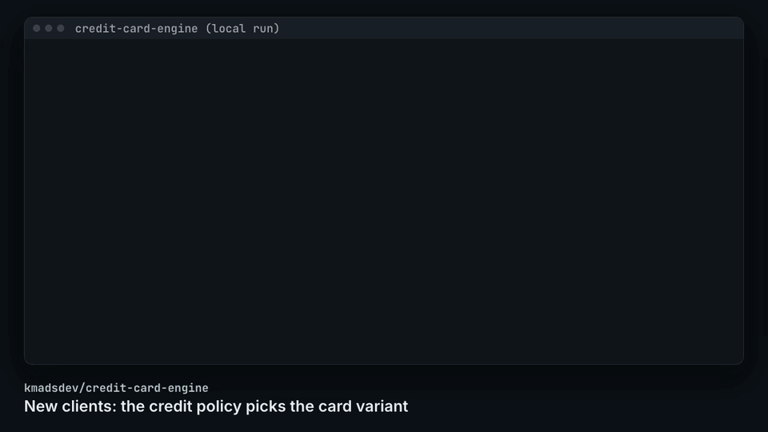
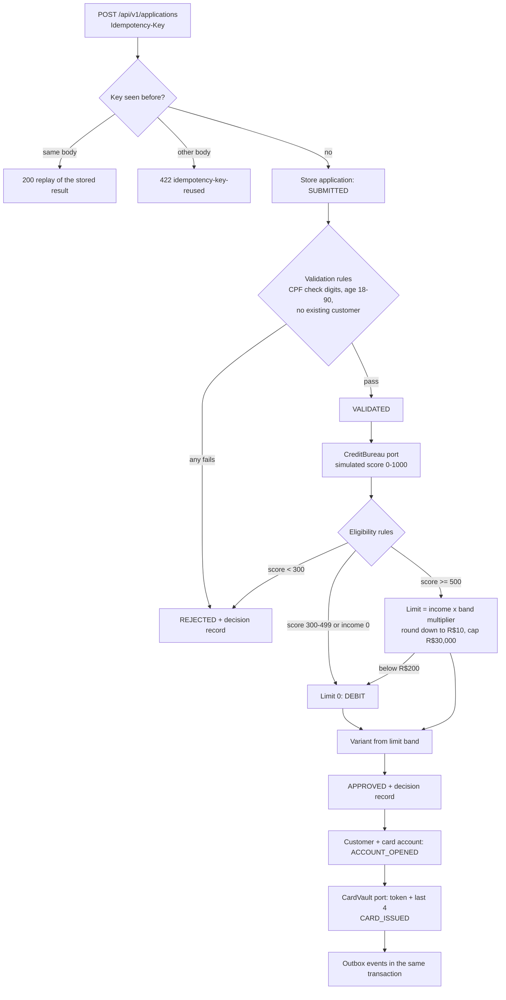
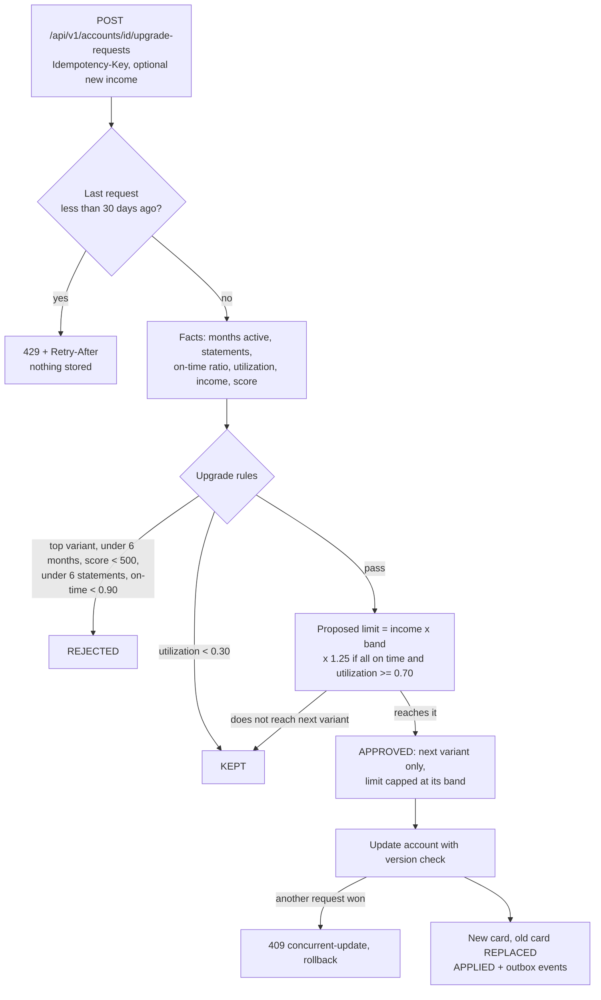
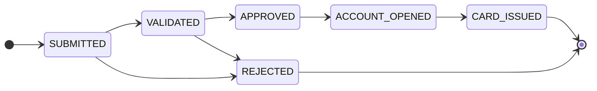
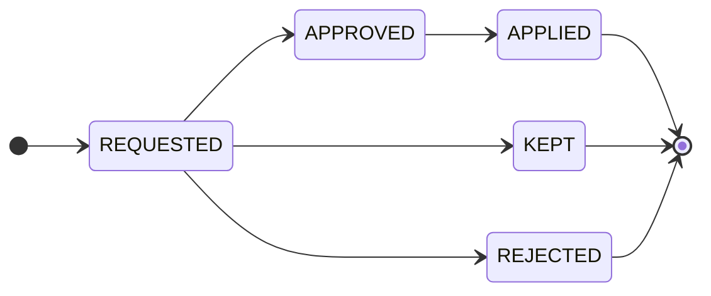

# credit-card-engine

[Leia em português](README.pt-br.md)



*Local run of the README walkthrough.*

A study and showcase project: a backend that runs the acquisition flow (new clients) and
the upgrade flow (existing clients) for four card variants. All data is simulated: the
credit bureau, the card vault and the event broker are local stand-ins, and every CPF
in the tests is generated at run time.

Java 21, Spring Boot 3.5, Spring Data JPA, PostgreSQL 16, Flyway, JUnit 5,
Testcontainers, ArchUnit, springdoc OpenAPI, Docker, GitHub Actions.

## Card variants

| Variant | Credit limit (BRL) | Rule |
|---|---|---|
| `DEBIT` | 0.00 | limit is exactly 0 |
| `CREDIT_BASE` | 0.01 to 2,000.00 | > 0 and <= 2,000.00 |
| `CREDIT_PLATINUM` | 2,000.01 to 8,000.00 | > 2,000.00 and <= 8,000.00 |
| `CREDIT_BLACK` | 8,000.01 and up (engine cap 30,000.00) | > 8,000.00 |

The variant always follows from the limit. The bands are one table in
[`CreditPolicy`](src/main/java/io/github/kmadsdev/cardengine/domain/policy/CreditPolicy.java),
and the tests check 2000.00, 2000.01, 8000.00 and 8000.01 exactly.

## Acquisition flow (new client)



## Upgrade flow (existing client)



There is no downgrade path: the policy only proposes the next variant, and the account
entity refuses any variant that is not higher.

## State machines





Any other move throws `IllegalStateTransitionException`. `StateMachineTest` checks every
(from, to) pair of both machines against a table written out by hand.

## Run it

You need Docker. Nothing else is required to run the app.

```bash
docker compose up --build
```

This starts PostgreSQL and the app on port 8080 with the `demo` profile. The profile
creates one existing client (a `CREDIT_BASE` account opened 13 months ago with 12
statements paid on time), so the upgrade flow can be tried at once.

- OpenAPI UI: http://localhost:8080/swagger-ui.html
- Readiness: http://localhost:8080/actuator/health/readiness
- Metrics: http://localhost:8080/actuator/prometheus

Stop it with `docker compose down -v`.

To build and test locally you need JDK 21 and Docker (for Testcontainers):

```bash
./mvnw verify        # unit, slice, ArchUnit, integration tests, JaCoCo report and gate
```

The coverage report is in `target/site/jacoco/index.html`.

## Try the flows with curl

Acquisition. The script prints a random synthetic CPF with valid check digits. The
outcome depends on the simulated score of that CPF, so it can be any variant.

```bash
CPF=$(./scripts/synthetic-cpf.sh)
curl -s -X POST localhost:8080/api/v1/applications \
  -H 'Content-Type: application/json' \
  -H "Idempotency-Key: demo-$(date +%s)" \
  -d "{\"cpf\":\"$CPF\",\"fullName\":\"Maria Example\",\"birthDate\":\"1992-04-18\",\"declaredMonthlyIncome\":4500.00}"
```

Part of a response (debit, because this CPF got a simulated score of 498):

```json
{
  "status": "CARD_ISSUED",
  "cpfMasked": "***.***.***-29",
  "variant": "DEBIT",
  "creditLimit": 0.00,
  "decision": {
    "outcome": "APPROVED",
    "policyVersion": "2026-11.1",
    "reasons": [
      { "code": "SCORE_DEBIT_ONLY", "effect": "DEBIT_ONLY", "detail": "score 498 is below 500, credit is not offered" },
      { "code": "VARIANT_ASSIGNED", "effect": "INFO", "detail": "limit 0.00 falls in the DEBIT band" }
    ]
  }
}
```

Upgrade of the demo account (the oldest account):

```bash
ACCOUNT_ID=$(curl -s 'localhost:8080/api/v1/accounts?sort=openedAt,asc&size=1' \
  | python3 -c 'import sys, json; print(json.load(sys.stdin)["content"][0]["id"])')

curl -s -X POST "localhost:8080/api/v1/accounts/$ACCOUNT_ID/upgrade-requests" \
  -H "Idempotency-Key: upgrade-$(date +%s)"
```

```json
{
  "status": "APPLIED",
  "fromVariant": "CREDIT_BASE",
  "toVariant": "CREDIT_PLATINUM",
  "toLimit": 8000.00,
  "decision": {
    "outcome": "APPROVED",
    "reasons": [
      { "code": "HISTORY_BONUS", "effect": "INFO", "detail": "all statements on time and utilization at least 0.70: limit x 1.25" },
      { "code": "SCORE_BAND", "effect": "INFO", "detail": "score 773 in band 750-849: limit = income 5000.00 x 2.0 x 1.25 = 12500.00" },
      { "code": "LIMIT_CAPPED_AT_VARIANT", "effect": "INFO", "detail": "proposed limit 12500.00 capped at the CREDIT_PLATINUM maximum 8000.00: an upgrade moves one variant only" },
      { "code": "UPGRADE_TO_NEXT_VARIANT", "effect": "INFO", "detail": "CREDIT_BASE -> CREDIT_PLATINUM, limit 2000.00 -> 8000.00" }
    ]
  }
}
```

Run the same upgrade again with a new key and you get `429` with `Retry-After` (30-day
cooldown). Run it with the same key and you get the stored result with
`Idempotent-Replayed: true`.

## API

| Method | Path | What it does |
|---|---|---|
| POST | `/api/v1/applications` | Runs the acquisition flow. Needs `Idempotency-Key`. |
| GET | `/api/v1/applications/{id}` | One application with its decision record. |
| GET | `/api/v1/applications?status=&page=&size=&sort=` | Paged list. |
| GET | `/api/v1/accounts/{id}` | One card account. |
| GET | `/api/v1/accounts?page=&size=&sort=` | Paged list. |
| GET | `/api/v1/accounts/{id}/cards` | Cards of an account (masked). |
| POST | `/api/v1/accounts/{id}/upgrade-requests` | Runs the upgrade flow. Needs `Idempotency-Key`. |
| GET | `/api/v1/accounts/{id}/upgrade-requests` | Paged list. |
| GET | `/api/v1/upgrade-requests/{id}` | One upgrade request with its decision record. |
| GET | `/api/v1/cards/{id}` | One card (masked). |

Errors are RFC 7807 `application/problem+json` with a stable `type`
(`urn:card-engine:problem:<code>`): `validation` (400), `not-found` (404),
`concurrent-update` and `illegal-state-transition` (409), `idempotency-key-reused` and
other business errors (422), `upgrade-cooldown` (429). Page size is capped at 100.

## Design decisions

Each one has an ADR in [`docs/adr/`](docs/adr/).

1. **Layers and ports** ([0001](docs/adr/0001-layers-and-ports.md)). `api -> application -> domain / persistence`.
   The bureau, the vault and the event broker are ports. ArchUnit enforces it, and the
   `domain` package may depend on the JDK only.
2. **One table-driven policy engine** ([0002](docs/adr/0002-policy-engine.md)). Every rule and
   number is in `CreditPolicy.java`. Each rule that fires adds a reason code, so every
   decision is stored with the reasons and the policy version that made it.
3. **Simulated bureau** ([0003](docs/adr/0003-simulated-bureau.md)). A deterministic hash of the
   CPF. No real bureau is called. The ADR says where a real one plugs in.
4. **No card number in the engine** ([0004](docs/adr/0004-card-tokenization.md)). The vault port returns
   a token and the last 4 digits. The database has no column for a full number.
5. **Transactional outbox** ([0005](docs/adr/0005-transactional-outbox.md)). Events are written in the
   same transaction as the change and published by a scheduled job through a port.
   The adapter writes them to the log; no broker is used.
6. **Optimistic locking and cooldown** ([0006](docs/adr/0006-upgrade-concurrency.md)). Every upgrade
   request writes the account row (the cooldown time lives there), so of two concurrent
   requests for one account only one commits, whatever the policy outcome.
   `ConcurrentUpgradeIT` forces the race with a barrier, so the test is deterministic.
7. **Idempotency keys and money** ([0007](docs/adr/0007-idempotency-and-money.md)). Key plus request
   hash; `BigDecimal` with scale 2, never rounded on input.

Observability: JSON logs (one object per line) with a correlation id
(`X-Correlation-Id`), a masking decorator that rewrites CPF-shaped and card-number-shaped
text in every field (`LogMaskingTest` proves it on the real config), Actuator liveness
and readiness, and Prometheus metrics (`cards_applications_decided_total`,
`cards_upgrades_decided_total`, `cards_upgrades_conflicts_total`, `cards_outbox_pending`).

## Tests

| Kind | Where | What |
|---|---|---|
| Unit | `domain/` | Policy decision tables, exact band boundaries, property-style invariants (5,000 generated inputs per flow, fixed seed), both state machines, CPF, Luhn, money |
| Slice | `api/ApiSliceTest` | HTTP mapping and problem details with the use cases mocked |
| Integration | `*IT` | Both flows over HTTP, idempotency, cooldown, outbox, concurrent upgrades, concurrent applications for one CPF, actuator, on PostgreSQL 16 through Testcontainers |
| Architecture | `architecture/ArchitectureTest` | Layering and a plain-Java domain |
| Logging | `observability/LogMaskingTest` | CPF and card numbers masked in message, arguments and stack trace |

JaCoCo merges unit and integration coverage; the build fails under 80% line coverage.

## What is not built

- No real credit bureau, card vault, card network or message broker. All three ports
  have simulated adapters only.
- No authentication or authorization. Every endpoint is open.
- No encryption at rest for the CPF and name columns, and no data retention policy.
- No card authorization, billing, statements or payments. The payment history the
  upgrade flow reads is a simulated table.
- No pending state for a bureau outage, and no manual review queue.
- No downgrade or cancellation flow.
- No dead-letter handling for events that keep failing, and no cleanup of published
  outbox rows.
- Idempotency keys do not expire.
- No rate limiting beyond the upgrade cooldown.
- The credit numbers (score bands, multipliers, cooldown) are invented for this study.

## License

To be decided by the owner.
