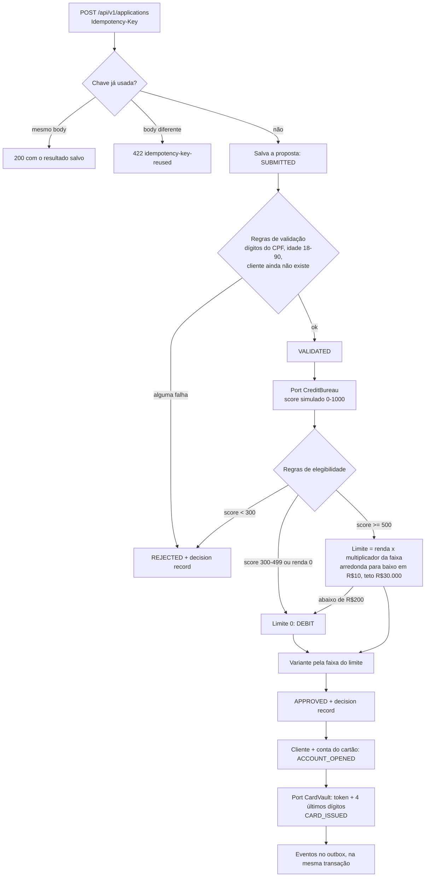
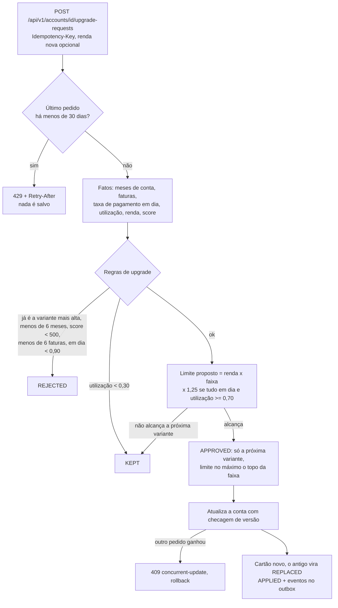
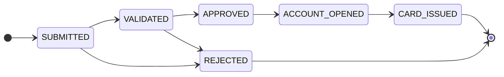
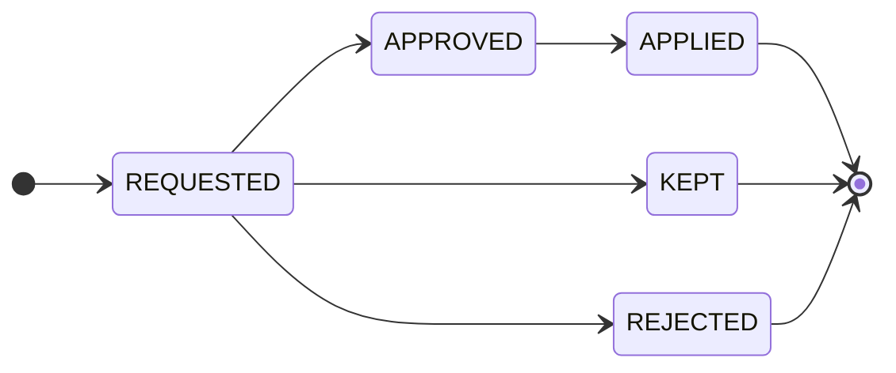

# credit-card-engine

[Read in English](README.md)

Projeto de estudo e portfólio: um backend que roda o fluxo de aquisição (cliente novo)
e o fluxo de upgrade (cliente existente) para quatro variantes de cartão. Todos os
dados são simulados: o bureau de crédito, o vault de cartões e o broker de eventos são
substitutos locais, e todo CPF usado nos testes é gerado na hora.

Java 21, Spring Boot 3.5, Spring Data JPA, PostgreSQL 16, Flyway, JUnit 5,
Testcontainers, ArchUnit, springdoc OpenAPI, Docker, GitHub Actions.

## Variantes de cartão

| Variante | Limite de crédito (R$) | Regra |
|---|---|---|
| `DEBIT` | 0,00 | limite exatamente 0 |
| `CREDIT_BASE` | 0,01 a 2.000,00 | > 0 e <= 2.000,00 |
| `CREDIT_PLATINUM` | 2.000,01 a 8.000,00 | > 2.000,00 e <= 8.000,00 |
| `CREDIT_BLACK` | a partir de 8.000,01 (teto do motor: 30.000,00) | > 8.000,00 |

A variante sempre sai do limite. As faixas ficam em uma tabela só, dentro do
[`CreditPolicy`](src/main/java/io/github/kmadsdev/cardengine/domain/policy/CreditPolicy.java),
e os testes conferem 2000.00, 2000.01, 8000.00 e 8000.01 exatamente.

## Fluxo de aquisição (cliente novo)



## Fluxo de upgrade (cliente existente)



Não existe caminho de downgrade: a policy só propõe a próxima variante, e a entidade da
conta recusa qualquer variante que não seja mais alta.

## Máquinas de estado





Qualquer outra transição lança `IllegalStateTransitionException`. O `StateMachineTest`
confere todos os pares (de, para) das duas máquinas contra uma tabela escrita à mão.

## Como rodar

Só precisa de Docker para rodar a aplicação.

```bash
docker compose up --build
```

Isso sobe o PostgreSQL e a aplicação na porta 8080 com o profile `demo`. Esse profile
cria um cliente existente (uma conta `CREDIT_BASE` aberta há 13 meses, com 12 faturas
pagas em dia), para dar para testar o upgrade na hora.

- OpenAPI UI: http://localhost:8080/swagger-ui.html
- Readiness: http://localhost:8080/actuator/health/readiness
- Métricas: http://localhost:8080/actuator/prometheus

Para parar: `docker compose down -v`.

Para compilar e testar localmente, precisa de JDK 21 e Docker (por causa do Testcontainers):

```bash
./mvnw verify        # unitários, slice, ArchUnit, integração, relatório e gate do JaCoCo
```

O relatório de cobertura fica em `target/site/jacoco/index.html`.

## Testando os fluxos com curl

Aquisição. O script gera um CPF sintético aleatório com dígitos verificadores válidos.
O resultado depende do score simulado desse CPF, então pode sair qualquer variante.

```bash
CPF=$(./scripts/synthetic-cpf.sh)
curl -s -X POST localhost:8080/api/v1/applications \
  -H 'Content-Type: application/json' \
  -H "Idempotency-Key: demo-$(date +%s)" \
  -d "{\"cpf\":\"$CPF\",\"fullName\":\"Maria Exemplo\",\"birthDate\":\"1992-04-18\",\"declaredMonthlyIncome\":4500.00}"
```

Trecho de uma resposta (débito, porque esse CPF tirou score simulado 498):

```json
{
  "status": "CARD_ISSUED",
  "cpfMasked": "***.***.***-29",
  "variant": "DEBIT",
  "creditLimit": 0.0,
  "decision": {
    "outcome": "APPROVED",
    "policyVersion": "2026-11.1",
    "reasons": [
      { "code": "SCORE_DEBIT_ONLY", "effect": "DEBIT_ONLY", "detail": "score 498 is below 500, credit is not offered" },
      { "code": "VARIANT_ASSIGNED", "effect": "INFO", "detail": "limit 0.00 falls in the DEBIT band" }
    ]
  }
}
```

Upgrade da conta demo (a conta mais antiga):

```bash
ACCOUNT_ID=$(curl -s 'localhost:8080/api/v1/accounts?sort=openedAt,asc&size=1' \
  | python3 -c 'import sys, json; print(json.load(sys.stdin)["content"][0]["id"])')

curl -s -X POST "localhost:8080/api/v1/accounts/$ACCOUNT_ID/upgrade-requests" \
  -H "Idempotency-Key: upgrade-$(date +%s)"
```

```json
{
  "status": "APPLIED",
  "fromVariant": "CREDIT_BASE",
  "toVariant": "CREDIT_PLATINUM",
  "toLimit": 8000.0,
  "decision": {
    "outcome": "APPROVED",
    "reasons": [
      { "code": "HISTORY_BONUS", "effect": "INFO", "detail": "all statements on time and utilization at least 0.70: limit x 1.25" },
      { "code": "SCORE_BAND", "effect": "INFO", "detail": "score 773 in band 750-849: limit = income 5000.00 x 2.0 x 1.25 = 12500.00" },
      { "code": "UPGRADE_TO_NEXT_VARIANT", "effect": "INFO", "detail": "CREDIT_BASE -> CREDIT_PLATINUM, limit 2000.00 -> 8000.00" }
    ]
  }
}
```

Se repetir o upgrade com outra chave, volta `429` com `Retry-After` (cooldown de 30
dias). Com a mesma chave, volta o resultado salvo com `Idempotent-Replayed: true`.

## API

| Método | Caminho | O que faz |
|---|---|---|
| POST | `/api/v1/applications` | Roda o fluxo de aquisição. Exige `Idempotency-Key`. |
| GET | `/api/v1/applications/{id}` | Uma proposta com o decision record. |
| GET | `/api/v1/applications?status=&page=&size=&sort=` | Lista paginada. |
| GET | `/api/v1/accounts/{id}` | Uma conta de cartão. |
| GET | `/api/v1/accounts?page=&size=&sort=` | Lista paginada. |
| GET | `/api/v1/accounts/{id}/cards` | Cartões da conta (mascarados). |
| POST | `/api/v1/accounts/{id}/upgrade-requests` | Roda o fluxo de upgrade. Exige `Idempotency-Key`. |
| GET | `/api/v1/accounts/{id}/upgrade-requests` | Lista paginada. |
| GET | `/api/v1/upgrade-requests/{id}` | Um pedido de upgrade com o decision record. |
| GET | `/api/v1/cards/{id}` | Um cartão (mascarado). |

Os erros seguem a RFC 7807 (`application/problem+json`) com um `type` estável
(`urn:card-engine:problem:<code>`): `validation` (400), `not-found` (404),
`concurrent-update` e `illegal-state-transition` (409), `idempotency-key-reused` e
outros erros de negócio (422), `upgrade-cooldown` (429). O tamanho de página vai até 100.

## Decisões de design

Cada uma tem um ADR em [`docs/adr/`](docs/adr/) (em inglês).

1. **Camadas e ports** ([0001](docs/adr/0001-layers-and-ports.md)). `api -> application -> domain / persistence`.
   Bureau, vault e broker de eventos são ports. O ArchUnit garante isso, e o pacote
   `domain` só pode depender do JDK.
2. **Um motor de policy guiado por tabelas** ([0002](docs/adr/0002-policy-engine.md)). Toda regra e
   todo número estão no `CreditPolicy.java`. Cada regra que dispara adiciona um código de
   motivo, então toda decisão fica salva com os motivos e a versão da policy.
3. **Bureau simulado** ([0003](docs/adr/0003-simulated-bureau.md)). Um hash determinístico do CPF.
   Nenhum bureau real é chamado. O ADR mostra onde um bureau real entraria.
4. **O número do cartão não entra no motor** ([0004](docs/adr/0004-card-tokenization.md)). O port do vault
   devolve um token e os 4 últimos dígitos. O banco não tem coluna para o número completo.
5. **Transactional outbox** ([0005](docs/adr/0005-transactional-outbox.md)). Os eventos são gravados na
   mesma transação da mudança e publicados por um job agendado através de um port. O
   adapter escreve no log; nenhum broker é usado.
6. **Optimistic locking e cooldown** ([0006](docs/adr/0006-upgrade-concurrency.md)). Dois upgrades
   simultâneos da mesma conta não aplicam os dois. O `ConcurrentUpgradeIT` força a
   corrida com uma barreira, então o teste é determinístico.
7. **Idempotency keys e dinheiro** ([0007](docs/adr/0007-idempotency-and-money.md)). Chave mais hash do
   request; `BigDecimal` com escala 2, sem arredondar a entrada.

Observabilidade: logs em JSON (um objeto por linha) com correlation id
(`X-Correlation-Id`), um decorator de mascaramento que reescreve qualquer texto com cara
de CPF ou de número de cartão em todos os campos (o `LogMaskingTest` prova isso com a
configuração real), liveness e readiness do Actuator, e métricas Prometheus
(`cards_applications_decided_total`, `cards_upgrades_decided_total`,
`cards_upgrades_conflicts_total`, `cards_outbox_pending`).

## Testes

| Tipo | Onde | O quê |
|---|---|---|
| Unitário | `domain/` | Tabelas de decisão da policy, limites exatos das faixas, invariantes no estilo property-based (5.000 entradas geradas por fluxo, seed fixa), as duas máquinas de estado, CPF, Luhn, dinheiro |
| Slice | `api/ApiSliceTest` | Mapeamento HTTP e problem details com os use cases mockados |
| Integração | `*IT` | Os dois fluxos via HTTP, idempotência, cooldown, outbox, upgrades concorrentes, actuator, em PostgreSQL 16 via Testcontainers |
| Arquitetura | `architecture/ArchitectureTest` | Camadas e domínio em Java puro |
| Logs | `observability/LogMaskingTest` | CPF e número de cartão mascarados na mensagem, nos argumentos e no stack trace |

O JaCoCo junta a cobertura de unitários e integração; o build falha abaixo de 80% de linhas.

## O que não foi construído

- Nenhum bureau de crédito, vault de cartões, bandeira ou broker de mensagens real. Os
  três ports só têm adapters simulados.
- Sem autenticação nem autorização. Todos os endpoints estão abertos.
- Sem criptografia em repouso para as colunas de CPF e nome, e sem política de retenção.
- Sem autorização de compras, faturamento, faturas ou pagamentos. O histórico de
  pagamentos que o upgrade lê é uma tabela simulada.
- Sem estado pendente para indisponibilidade do bureau, e sem fila de análise manual.
- Sem fluxo de downgrade ou cancelamento.
- Sem dead-letter para eventos que falham sempre, e sem limpeza das linhas já publicadas
  do outbox.
- As idempotency keys não expiram.
- Sem rate limiting além do cooldown de upgrade.
- Os números de crédito (faixas de score, multiplicadores, cooldown) foram inventados
  para este estudo.

## Licença

A definir pelo dono.
